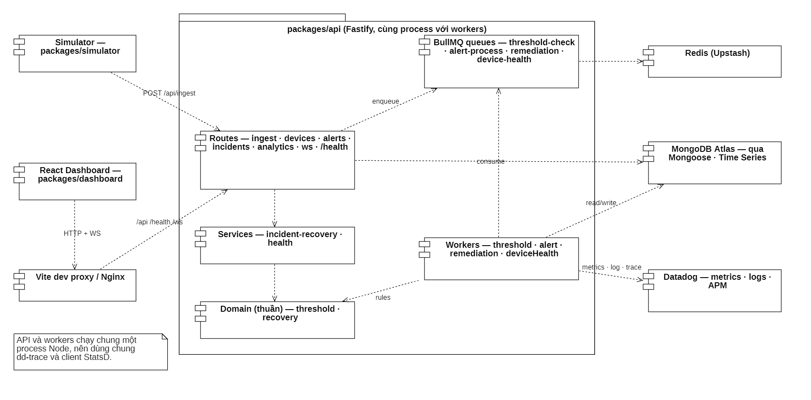

# SensorGuard

Industrial IoT monitoring demo for the MongoDB × Datadog Hackathon: simulated sensor data, time-series analytics, incident processing and evidence-based recovery.

## Architecture

[](https://github.com/ddloi/sensorguard-iot/blob/main/docs/uml/images/ARC-01.png)

Direct links to the architecture diagrams:

| Diagram                                      | Link                                                                                            |
| -------------------------------------------- | ----------------------------------------------------------------------------------------------- |
| Components and data flow                     | [ARC-01](https://github.com/ddloi/sensorguard-iot/blob/main/docs/uml/images/ARC-01.png)         |
| Docker deployment                            | [ARC-02](https://github.com/ddloi/sensorguard-iot/blob/main/docs/uml/images/ARC-02.png)         |
| MongoDB data model                           | [ARC-04](https://github.com/ddloi/sensorguard-iot/blob/main/docs/uml/images/ARC-04.png)         |
| BullMQ queue pipeline                        | [ARC-05](https://github.com/ddloi/sensorguard-iot/blob/main/docs/uml/images/ARC-05.png)         |
| Datadog observability                        | [ARC-06](https://github.com/ddloi/sensorguard-iot/blob/main/docs/uml/images/ARC-06.png)         |
| All 27 UML diagrams (StarUML model + images) | [docs/uml](https://github.com/ddloi/sensorguard-iot/tree/main/docs/uml)                         |
| Written architecture and boundaries          | [docs/architecture.md](https://github.com/ddloi/sensorguard-iot/blob/main/docs/architecture.md) |

Reused components, data sources and AI tools are declared in [docs/declarations.md](docs/declarations.md).

## Live demo

**https://sensorguard-hnnh.onrender.com** · press **Chạy demo quá nhiệt** to watch detect → investigate → resolve (about 13 seconds). Health check: [/health](https://sensorguard-hnnh.onrender.com/health).

The hosted demo runs on Render from [`render.yaml`](render.yaml): one free web service (API, workers, dashboard and simulator) plus a free Key Value instance for BullMQ. See [docs/deploy-render.md](docs/deploy-render.md) for the setup steps and limits; the free service sleeps after 15 idle minutes and takes about a minute to wake.

## Run locally

Use Node.js 20+ and npm 10+. MongoDB Atlas and Redis are external services. Datadog is optional for local monitoring; verify actual delivery before presenting its integration.

```bash
npm ci
```

Copy `.env.example` to `.env` and provide your connection settings. Keep credentials on the server; never put them in `VITE_*` variables.

For a **new, empty demo database only**, run `npm run seed`. This command deletes and replaces devices, thresholds, alerts and incidents. Existing demo databases do not need reseeding after UI or structure changes.

```bash
npm run dev
```

Open [the dashboard](http://localhost:3000). The API listens on port 3001 and the simulator sends readings every five seconds. To check running services:

```bash
npm run verify
```

### Redis usage and local Redis

BullMQ runs its queue logic in Lua scripts, and Upstash bills every command inside a script. To keep the free quota usable, the API compares each batch with the thresholds itself and only queues a threshold job when a reading violates a rule, a warning or offline device needs restoring, or a warning alert is still active. Idle workers also wait longer between polls. Measured on Upstash with the simulator running: about 3,280 commands per minute before, about 190 after.

For rehearsals without any quota, run Redis in Docker and point the app at it:

```bash
npm run redis:local
```

Then set `UPSTASH_REDIS_URL=redis://localhost:6379` in `.env`. TLS follows the URL scheme (`rediss://` uses TLS). Stop it with `npm run redis:local:stop`.

Without Docker, Windows users with an Ubuntu WSL distro can install Redis there once (`sudo apt install redis-server`) and keep it running in a separate terminal with `npm run redis:wsl`; WSL forwards `localhost:6379` to Windows.

### Device key

Set `DEVICE_API_KEY` in `.env` to require the header `x-device-key` on `POST /api/ingest`; the simulator sends it automatically. The dashboard demo button calls `POST /api/demo/overheat`, which injects a fixed MOTOR-001 sample on the server, so the browser never holds the key. When the variable is empty, ingest stays open for local demos and the API logs a warning.

## Project layout

```text
sensorguard/
├── packages/
│   ├── api/
│   │   ├── src/
│   │   │   ├── config/       # Environment and external connections
│   │   │   ├── domain/       # Pure threshold and recovery rules
│   │   │   ├── models/       # MongoDB schemas
│   │   │   ├── queues/       # BullMQ queues
│   │   │   ├── routes/       # HTTP and WebSocket entry points
│   │   │   ├── services/     # Use cases and dependency health
│   │   │   ├── utils/        # Logging and WebSocket infrastructure
│   │   │   └── workers/      # Background incident processing
│   │   ├── scripts/          # Explicit database setup and manual diagnostics
│   │   └── tests/            # unit/ and integration/
│   ├── dashboard/
│   │   ├── src/
│   │   │   ├── api/          # Typed HTTP client
│   │   │   ├── components/   # Reusable UI and application shell
│   │   │   ├── features/     # Telemetry, incidents and architecture screens
│   │   │   ├── hooks/        # State, polling, WebSocket and demo actions
│   │   │   ├── types/        # Dashboard data contracts
│   │   │   └── utils/        # Presentation helpers
│   │   └── nginx.conf        # Container proxy and SPA fallback
│   └── simulator/
│       └── src/              # Configuration, equipment and scenarios
├── scripts/
│   └── verify-stack.ts       # Read-only live preflight
├── datadog/                  # Dashboard and monitor definitions
├── docs/                     # Architecture, development and demo guides
│   ├── demo/
│   ├── reference/
│   ├── uml/                  # StarUML model and exported diagrams
│   └── archive/              # Historical design/pipeline material
├── PRODUCT.md                # Product purpose and design principles
├── DESIGN.md                 # Current visual system
├── tsconfig.base.json        # Shared strict TypeScript settings
└── docker-compose.yml        # API, dashboard, simulator and Datadog Agent
```

The three workspaces are independently buildable. Domain rules do not import Fastify or React; browser code communicates through HTTP and WebSocket instead of importing API implementation files.

## Validation

```bash
npm run check         # Types, unit/integration tests, builds and formatting
npm run verify        # Running API, data, WebSocket and dashboard checks
npm run test:mongo    # Real MongoDB tests; needs MONGODB_TEST_URI (uses a throwaway database)
npm run format        # Apply consistent formatting
```

`check` requires no cloud credentials or running database. `verify` needs the stack running and does not trigger an incident or reset data. `test:mongo` is skipped unless `MONGODB_TEST_URI` is set; CI runs it against a MongoDB 7 service container. CI fails when tests or formatting fail.

## Demo

Click **Chạy demo quá nhiệt** for MOTOR-001. The dashboard opens incident history and follows detection, simulated diagnosis/mitigation and recovery confirmed from fresh safe readings. A failed verification stays visible for operator review; **Kiểm tra phục hồi lại** starts another bounded check without force-closing the incident.

Sensor input, root-cause diagnosis and cooling actions are simulated. MongoDB storage, BullMQ processing and incident records use the configured services. The Datadog badge reports configuration, not proof of ingestion.

- [Architecture and boundaries](docs/architecture.md)
- [UML diagrams: 27 StarUML diagrams with images, Vietnamese](docs/uml/README.md)
- [Datadog dashboard, monitors and metric list, Vietnamese](datadog/README.md)
- [Development and commands](docs/development.md)
- [Three-minute presentation, Vietnamese](docs/demo/presentation-vi.md)
- [Demo readiness and caveats](docs/demo/readiness.md)
- [Technology and Datadog reference](docs/reference/technology-and-datadog-agent.txt)
- [Historical material](docs/archive/README.md)

## Docker

```bash
npm run docker:up
npm run docker:logs
npm run docker:down
```

The dashboard container serves the built SPA and proxies `/api`, `/health` and `/ws` to the API. MongoDB and Redis remain external; the compose stack includes the Datadog Agent. Configure `.env` first. See [development notes](docs/development.md#docker) for validation limits.

MIT
