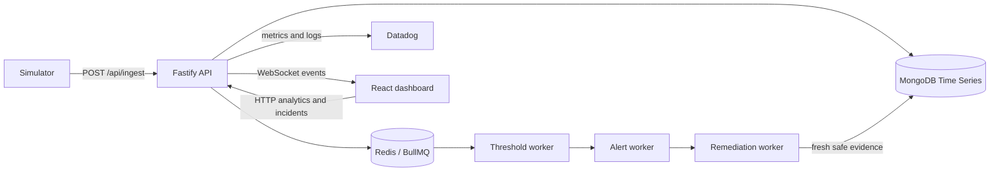

# Architecture

SensorGuard is a small npm-workspace monorepo. Keep the three executable applications separate; a shared framework or extra service layer is unnecessary for the current scope.

## Data flow

## API responsibilities

| Directory      | Responsibility                                                     | Dependency boundary                             |
| -------------- | ------------------------------------------------------------------ | ----------------------------------------------- |
| `src/config`   | Environment, MongoDB, Redis and telemetry configuration            | External libraries/settings                     |
| `src/domain`   | Threshold selection and recovery evidence rules                    | Pure inputs and outputs; no DB/HTTP/queue calls |
| `src/models`   | Mongoose schemas and indexes                                       | Persistence declarations                        |
| `src/routes`   | Request validation, response codes and HTTP/WebSocket registration | Calls services/models where appropriate         |
| `src/services` | Incident recovery use case and service health                      | Coordinates DB, queue and events                |
| `src/queues`   | BullMQ queue lifecycle                                             | Redis                                           |
| `src/workers`  | Background threshold, alert, remediation and heartbeat workflows   | Domain rules, models and queues                 |
| `src/utils`    | Logging and connected WebSocket delivery                           | Infrastructure helpers                          |

`src/index.ts` initializes tracing before server modules. `src/server.ts` assembles routes, connections and workers. The recheck service claims an incident before queueing, namespaces the verification run, and restores review state when queueing fails.

Device-specific thresholds take precedence over wildcard rules. Wildcards also match equipment type. Recovery needs fresh telemetry newer than the incident and inside configured safety bands; a timer alone cannot prove recovery.

## Dashboard responsibilities

`src/App.tsx` composes the application. HTTP access belongs in `src/api`; hooks own fetching, cancellation, polling, reconnects, theme and demo action state. Components render reusable controls and the shell. Feature views render telemetry, incidents and architecture. Types describe responses; helpers format timestamps, sensor labels and derived state.

Maintain these behaviors when editing:

- A stale response from an earlier selected device must not populate the current chart.
- Request cancellation, intervals and WebSocket reconnects must clean up on unmount.
- A service connection is different from fresh sensor data and from Datadog delivery.
- Demo buttons remain disabled when prerequisites are unavailable or an incident is in progress.
- Mobile device selection stays available when the sidebar is hidden.

The backend and frontend retain their own transport representations; the browser does not import Mongoose models. A shared-contract workspace can be introduced later if the public API grows enough to justify it.

## Simulator and operations

`packages/simulator/src/config.ts` resolves configuration independently of the caller's working directory. `devices.ts` defines equipment and normal ranges; `scenarios/overheat.ts` drives the longer narrated scenario. API seeding is a separate explicit operation with its own database fixtures, not part of application startup or tests.

The Vite development server and Nginx container both forward `/api`, `/health` and `/ws`. Runtime secrets are supplied through server-side environment configuration. No frontend secret injection is required.

## Tests and verification

Unit tests cover domain rules, validation and service health. Route integration tests use Fastify injection with mocked database/queue dependencies; they do not constitute a real database integration test. `npm run verify` separately checks running services and real data without mutating the database.

The API still starts workers in the same process. This is practical for the hackathon; splitting API and workers into separately deployed processes is a future scaling decision, not a prerequisite for the demo.
