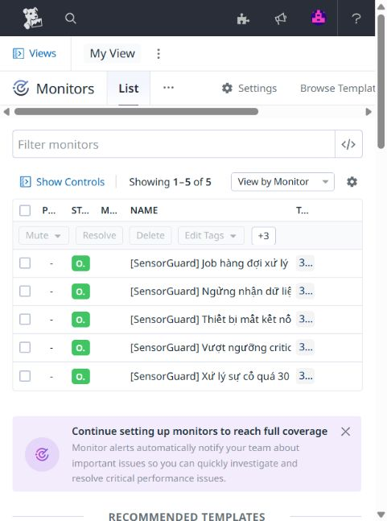
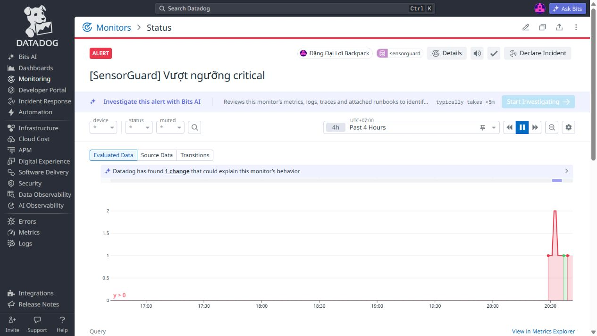
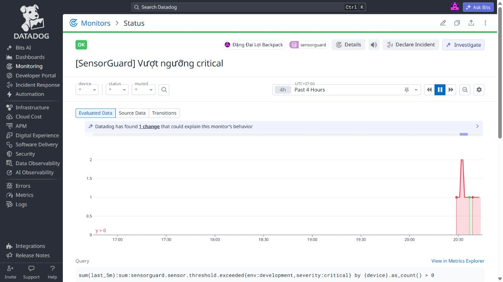
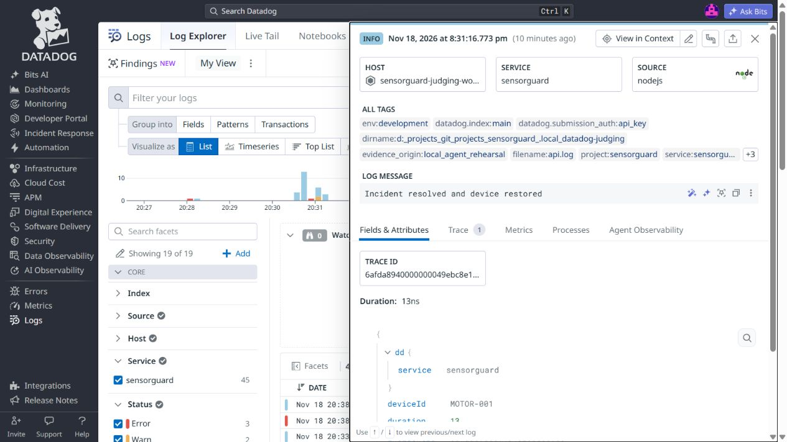
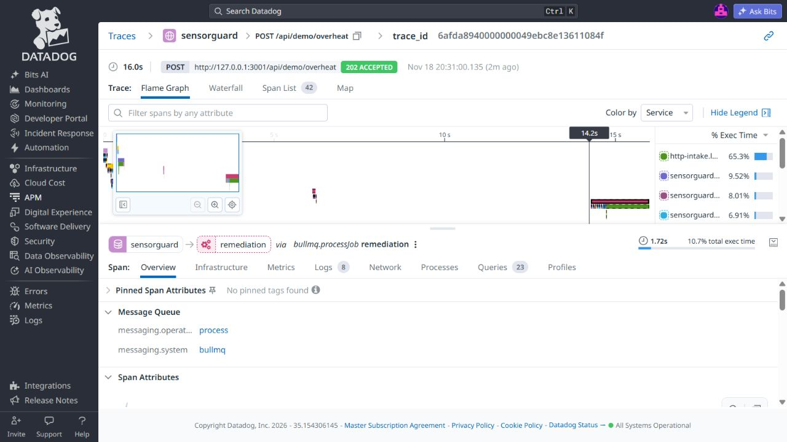

# Biên bản kiểm chứng Datadog Cloud — 18/11/2026

Đây là bằng chứng bổ sung sau báo cáo đã nộp. Các số liệu và giới hạn trong báo cáo trước được giữ nguyên. Ảnh trong thư mục là ảnh chụp giao diện Datadog US5 thực tế, không phải bản dựng minh họa. Thời gian dưới đây dùng UTC+7, trừ khi ghi rõ UTC.

## Phạm vi và nguồn dữ liệu

| Nguồn                                   | Đã kiểm chứng                                                                                                                | Giới hạn                                                                                                             |
| --------------------------------------- | ---------------------------------------------------------------------------------------------------------------------------- | -------------------------------------------------------------------------------------------------------------------- |
| Render: `sensorguard-hnnh.onrender.com` | Trang chủ và `/health` trả HTTP 200; MongoDB và Redis connected; demo MOTOR-001 được tiếp nhận; log sự cố xuất hiện trên US5 | `datadog:configured` trong health chỉ xác nhận cấu hình. Render hiện tắt APM vì chưa có Agent cho dịch vụ này.       |
| Windows: cùng ứng dụng, API cổng 3001   | Agent chuyển log tệp và trace lên US5; trace detail hiển thị đầy đủ; log liên kết đúng trace                                 | Cần máy, Redis, simulator, API và Agent tiếp tục chạy. Đây là buổi chạy local, không phải trace phát sinh từ Render. |
| Datadog US5                             | 5 monitor được Save and Publish; critical đã ALERT và tự trở về OK theo cửa sổ đánh giá                                      | Chưa có bằng chứng chu kỳ ALERT → OK cho bốn điều kiện lỗi còn lại.                                                  |

Log và trace của buổi local có tag `evidence_origin:local_agent_rehearsal`, hostname `sensorguard-judging-workstation`, service `sensorguard`, env `development`. Metrics hiện dùng chung service/env giữa local và Render; không thể dùng biểu đồ tổng hợp đó để khẳng định nguồn riêng biệt. Không có mật khẩu, API key hay token trong bộ bằng chứng.

## Monitor đã triển khai

| ID                                                      | Monitor                 | Query và điều kiện                                                                    |
| ------------------------------------------------------- | ----------------------- | ------------------------------------------------------------------------------------- |
| [23862283](https://us5.datadoghq.com/monitors/23862283) | Vượt ngưỡng critical    | Tổng `sensor.threshold.exceeded`, severity critical, theo device, 5 phút > 0          |
| [23862290](https://us5.datadoghq.com/monitors/23862290) | Ngừng nhận dữ liệu      | Tổng `sensor.ingest.count`, 5 phút < 1                                                |
| [23862302](https://us5.datadoghq.com/monitors/23862302) | Thiết bị mất kết nối    | Max `device.count`, status offline, 5 phút > 0                                        |
| [23862309](https://us5.datadoghq.com/monitors/23862309) | Job hàng đợi xử lý chậm | Average của max `queue.job.duration`, theo queue, 5 phút > 5.000 ms; warning 2.000 ms |
| [23862324](https://us5.datadoghq.com/monitors/23862324) | Xử lý sự cố quá 30 giây | Max `incident.duration`, 15 phút > 30 giây; warning 20 giây                           |

Tất cả lọc `env:development`. Định nghĩa nằm trong [monitors.json](../../../datadog/monitors.json). Hai monitor đếm sử dụng **Evaluate as 0** khi thiếu mẫu: critical phục hồi sau khi cửa sổ 5 phút hết sự kiện; ingest đánh giá số mẫu 0 theo điều kiện `< 1` thay vì chỉ hiện NO DATA. Không sử dụng nút resolve thủ công để tạo ảnh phục hồi.

Bổ sung đo lường nhỏ: worker sức khỏe thiết bị gửi cả giá trị 0 cho từng trạng thái. Trước đó, khi không còn thiết bị offline, không có mẫu `status:offline` mới, khiến monitor không biết số lượng đã về 0. Không thay đổi ngưỡng hay quy tắc xử lý sự cố; có unit test cho offline 1 → 0.

## Kịch bản detect → investigate → resolve đã quan sát

1. **Detect:** gọi `POST /api/demo/overheat` trên Render lúc **20:28:05** (UTC `13:28:05`). Endpoint tiếp nhận ba số đo MOTOR-001. Monitor critical ghi **ALERT 20:28:43**.
2. **Investigate:** chạy lại cùng endpoint trên API local có Agent lúc **20:31:00.135**. Datadog hiển thị trace thật gồm API, `threshold-check`, `alert-process`, `remediation` và truy vấn MongoDB. Log `Incident resolved and device restored` liên kết đến cùng trace.
3. **Resolve:** ứng dụng ghi thời gian xử lý sự cố **13 giây**; Cloud trace toàn luồng dài **16 giây**, gồm cả các thao tác gửi log và truy vấn. Hai giá trị đo hai phạm vi khác nhau. Monitor tự ghi **OK lúc 20:36:43**, sau khi mẫu critical cuối cùng rời cửa sổ 5 phút.
4. Vòng kiểm chứng từ baseline OK: **OK 20:36:43 → gọi demo Render 20:38:40.742 → ALERT 20:38:43 → quan sát OK lúc 20:45**. Không dùng resolve thủ công. Tại lần kiểm tra cuối, cả năm monitor đều hiển thị OK. Thời điểm 20:45 là lúc đọc trạng thái, không khẳng định là timestamp chuyển trạng thái của evaluator.

| Trường        | Giá trị kiểm chứng                                       |
| ------------- | -------------------------------------------------------- |
| Trace ID      | `6afda8940000000049ebc8e13611084f`                       |
| Request       | `POST http://127.0.0.1:3001/api/demo/overheat`, HTTP 202 |
| Bắt đầu trace | 18/11/2026 20:31:00.135 UTC+7                            |
| Tổng trace    | 16,0 giây; 42 spans; 23 queries theo UI Cloud            |
| Log           | `Incident resolved and device restored`, MOTOR-001       |
| Log ingestion | 20:31:16.773 UTC+7                                       |

[Mở trace trên US5](https://us5.datadoghq.com/apm/trace/6afda8940000000049ebc8e13611084f?timeHint=1795008660135&trace__spanID=7672427034475957435). Với Logs Explorer, chọn 18/11/2026 khoảng 20:30–20:33 UTC+7, lọc `service:sensorguard host:sensorguard-judging-workstation`, mở log và tab **Trace**. Thời gian lưu Logs/Traces tùy cấu hình tài khoản; ảnh tĩnh vẫn được lưu trong repository.

## Ảnh chụp

### Năm monitor đã publish, có trạng thái OK

### Monitor critical ALERT

### Monitor tự phục hồi OK

### Log có trace ID

UI tự hiểu trường log `duration: 13` thành `13ns` trong summary mặc định. Giá trị ứng dụng này có đơn vị **giây**, theo code xử lý sự cố; không dùng summary `13ns` làm số liệu đánh giá hiệu năng.

### APM Cloud

## Hướng dẫn tái hiện cho giám khảo

1. Mở [demo Render](https://sensorguard-hnnh.onrender.com), kiểm tra `/health` và dữ liệu đang cập nhật.
2. Mở [public Datadog dashboard](https://p.us5.datadoghq.com/sb/e5ad17af-dbf4-11f1-b42f-ee5a36c85258-ea6401425bf74119e12bb0497cfb00b4). Dashboard này không cần đăng nhập.
3. Nếu có quyền tổ chức US5, mở monitor critical và chọn 15–30 phút gần nhất. Chờ baseline OK trước khi chạy một vòng mới.
4. Bấm **Chạy demo quá nhiệt** một lần. Xem lịch sử sự cố trong app, metric vi phạm và trạng thái ALERT của monitor. Ứng dụng phục hồi trước; monitor chờ hết cửa sổ 5 phút mới OK. Không bấm demo liên tục trong thời gian chờ.
5. Để tái hiện APM, cần chạy API có `DD_TRACE_ENABLED=true`, trỏ `DD_TRACE_AGENT_URL` đến Agent có APM bật, cùng `DD_SITE=us5.datadoghq.com`. Bật logs injection của tracer và cấu hình Agent tail tệp JSON của ứng dụng. Dùng `.env` riêng, không gửi khóa cho giám khảo hoặc đưa lên GitHub. Docker Compose trong repository là phương án có sẵn; buổi bằng chứng này dùng Windows Agent.
6. Chọn log cùng thời điểm, mở tab **Trace**, kiểm tra các span và truy vấn. Trace cũ trong ảnh được tạo từ local; bấm demo trên Render hiện chưa tạo APM trace.

## Giới hạn còn lại và vận hành ngày chấm

- Một lần quá nhiệt bình thường không tạo đủ năm loại lỗi. Chưa kiểm chứng độc lập chu kỳ cảnh báo/phục hồi cho mất ingest, thiết bị offline, queue chậm và sự cố >30 giây. Không tăng thời gian hay giả metric để tạo thành tích; không dừng dịch vụ công khai trong lúc chấm.
- Tự khắc phục hiện chạy bằng worker BullMQ của SensorGuard. Chưa có bằng chứng Datadog Webhook/Workflow kích hoạt khắc phục, cũng chưa cấu hình người nhận thông báo thật. Monitor phát hiện trên Cloud không đồng nghĩa đã có đường phản hồi từ Datadog về ứng dụng.
- Free Render có thể ngủ và cold start; không cam kết uptime. Workflow heartbeat kiểm tra mỗi bốn phút khi job đang chạy, tối đa 350 phút/job, lịch bốn giờ/lần trong ngày 18–19/11; lịch GitHub có thể trễ. Vòng lặp dừng trước **00:00 ngày 20/11/2026 UTC+7**. Không tự bơm demo mỗi giờ để tránh làm nhiễu đánh giá phục hồi.
- Có heartbeat Codex dự phòng mỗi 10 phút trong ngày chấm; phụ thuộc ứng dụng/máy chủ Codex tiếp tục hoạt động. Không dùng nó làm cam kết dịch vụ 24/7.
- Chi tiết monitor/log/trace cần tài khoản có quyền trong tổ chức Datadog. Public dashboard không tự cấp quyền cho các trang chi tiết đó. Giám khảo không đăng nhập vẫn xem được ảnh ở repository.
- Không thay đổi số liệu báo cáo trước đây. Các bằng chứng mới chỉ xác nhận lần chạy ngày 18/11 và phạm vi mô tả ở trên.

## Kiểm tra mã nguồn của bản bổ sung

- Typecheck API, simulator và dashboard: đạt.
- Build cả ba workspace: đạt.
- Preflight `npm run verify` lúc 20:45:56: **8 passed, 0 warnings, 0 failed**; API, MongoDB, Redis, dữ liệu mới, WebSocket và dashboard đều hoạt động.
- Unit/API tests: **79 passed, 4 skipped**. Bốn test cần MongoDB test URI không chạy vào database demo.
- Prettier trên toàn bộ tệp được Git quản lý và tệp mới của bản bổ sung: đạt. Lệnh gộp `npm run check` trên máy Windows bị chặn ở bước quét thư mục runtime Agent riêng `.local/` do quyền truy cập; không ghi nhận lệnh gộp này là thành công. CI chạy từ checkout sạch không chứa thư mục runtime đó.
- Test hồi quy bổ sung xác nhận metric số thiết bị offline chuyển từ 1 về 0 khi thiết bị cuối cùng phục hồi.
