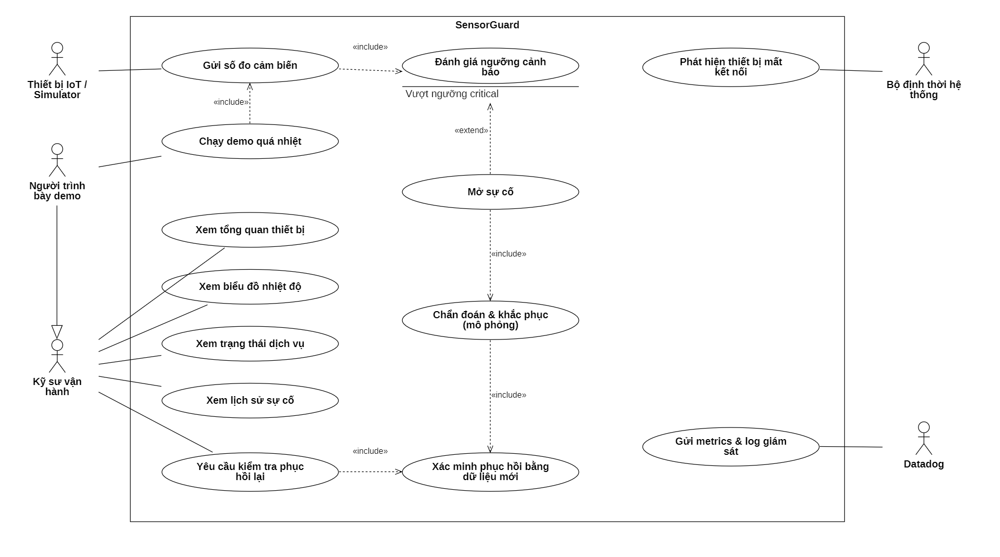
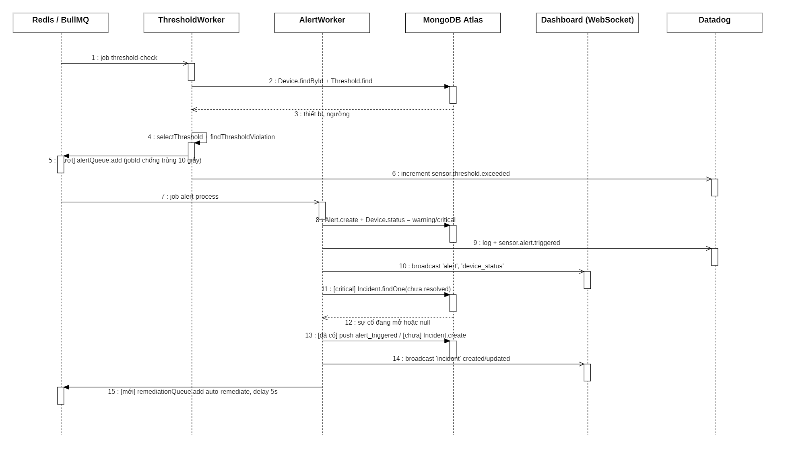
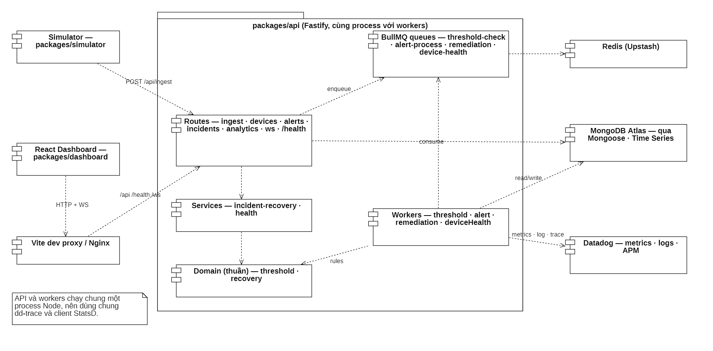

# Bộ sơ đồ UML SensorGuard

File StarUML: [SensorGuard.mdj](SensorGuard.mdj). Gồm 27 sơ đồ chia thành 6 nhóm, vẽ theo code hiện tại của dự án. Mỗi sơ đồ có ghi file nguồn trong ô **Documentation**, nên khi bảo vệ có thể chỉ ra ngay chức năng nằm ở đâu. Ảnh xuất sẵn nằm trong thư mục [images/](images/).

Toàn bộ sơ đồ dùng **đen trắng cơ bản**: nền trắng, viền và chữ đen. Chỉ có chấm bắt đầu/kết thúc và thanh rẽ nhánh song song là tô đen, đúng ký hiệu chuẩn UML.

## Danh mục sơ đồ

### 01 · Sơ đồ ca sử dụng (Use Case)

| Sơ đồ                     | Nội dung                              |
| ------------------------- | ------------------------------------- |
| [UC-01](images/UC-01.png) | Tổng quan: 5 tác nhân, 13 ca sử dụng  |
| [UC-02](images/UC-02.png) | Giám sát thiết bị và dữ liệu cảm biến |
| [UC-03](images/UC-03.png) | Sự cố và phục hồi                     |



### 02 · Sơ đồ hoạt động (Activity)

| Sơ đồ                       | Nội dung                                                                                                                 | File code                                |
| --------------------------- | ------------------------------------------------------------------------------------------------------------------------ | ---------------------------------------- |
| [ACT-01](images/ACT-01.png) | Tiếp nhận dữ liệu cảm biến: kiểm tra payload → lỗi 400/404 → lưu → gửi song song Datadog và WebSocket → đưa vào hàng đợi | `routes/ingest.ts`                       |
| [ACT-02](images/ACT-02.png) | Đánh giá ngưỡng, tạo cảnh báo; chỉ mức **critical** mới mở sự cố, có chống trùng                                         | `threshold.worker.ts`, `alert.worker.ts` |
| [ACT-03](images/ACT-03.png) | Khắc phục mô phỏng, xác minh mỗi 8 giây, tối đa 6 lần rồi chuyển lên cấp cao hơn (escalate)                              | `remediation.worker.ts`                  |
| [ACT-04](images/ACT-04.png) | Chạy demo quá nhiệt từ dashboard, chờ tối đa 60 giây                                                                     | `useIncidentActions.ts`                  |
| [ACT-05](images/ACT-05.png) | Yêu cầu kiểm tra phục hồi lại, các mã trả về 400/404/409/503/202                                                         | `incident-recovery.ts`                   |

### 03 · Sơ đồ tuần tự (Sequence)

| Sơ đồ                       | Nội dung                                                                                                                   |
| --------------------------- | -------------------------------------------------------------------------------------------------------------------------- |
| [SEQ-01](images/SEQ-01.png) | Gửi dữ liệu cảm biến                                                                                                       |
| [SEQ-02](images/SEQ-02.png) | Phát hiện vượt ngưỡng và mở sự cố                                                                                          |
| [SEQ-03](images/SEQ-03.png) | Khắc phục và xác minh phục hồi                                                                                             |
| [SEQ-04](images/SEQ-04.png) | Chạy demo quá nhiệt                                                                                                        |
| [SEQ-05](images/SEQ-05.png) | Yêu cầu kiểm tra phục hồi lại                                                                                              |
| [SEQ-06](images/SEQ-06.png) | Dashboard cập nhật thời gian thực: hỏi lại HTTP mỗi 5 giây, nhận sự kiện qua WebSocket, mất kết nối thì thử lại sau 4 giây |
| [SEQ-07](images/SEQ-07.png) | Phát hiện thiết bị mất kết nối sau 30 giây không có dữ liệu                                                                |



### 04 · Kiến trúc và dữ liệu

| Sơ đồ                       | Loại                    | Nội dung                                                                                                      |
| --------------------------- | ----------------------- | ------------------------------------------------------------------------------------------------------------- |
| [ARC-01](images/ARC-01.png) | Thành phần (Component)  | 3 gói của dự án và các tầng bên trong `packages/api`                                                          |
| [ARC-02](images/ARC-02.png) | Triển khai (Deployment) | Theo `docker-compose.yml`: dashboard, api, simulator, Datadog Agent; MongoDB Atlas và Upstash Redis nằm ngoài |
| [ARC-03](images/ARC-03.png) | Lớp (Class)             | Mô hình miền: Device, Threshold, SensorData, Alert, Incident chứa IncidentEvent                               |
| [ARC-04](images/ARC-04.png) | Lớp (Class)             | Các collection MongoDB, chỉ mục và thời hạn tự xóa 7 ngày của Time Series                                     |
| [ARC-05](images/ARC-05.png) | Thành phần (Component)  | 4 hàng đợi BullMQ, các worker, cơ chế chống trùng job và độ trễ                                               |
| [ARC-06](images/ARC-06.png) | Thành phần (Component)  | Giám sát với Datadog: dd-trace, StatsD, gửi dự phòng qua HTTP, log Winston                                    |



### 05 · Sơ đồ trạng thái (State Machine)

| Sơ đồ                       | Các trạng thái                                                  |
| --------------------------- | --------------------------------------------------------------- |
| [STM-01](images/STM-01.png) | Thiết bị: online, warning, critical, maintenance, offline       |
| [STM-02](images/STM-02.png) | Sự cố: open → mitigating → resolved; mitigating ⇄ investigating |
| [STM-03](images/STM-03.png) | Cảnh báo: active, acknowledged, resolved                        |

### 06 · Vận hành và bảo mật

| Sơ đồ                       | Nội dung                                                                                                 |
| --------------------------- | -------------------------------------------------------------------------------------------------------- |
| [OPS-01](images/OPS-01.png) | Ranh giới tin cậy: không đăng nhập là có chủ đích, chỉ chạy trên localhost, khóa bí mật chỉ nằm ở server |
| [OPS-02](images/OPS-02.png) | CI trên GitHub Actions: build và kiểm tra kiểu với Node 20/22, sau đó chạy test và Prettier              |
| [OPS-03](images/OPS-03.png) | Chuẩn bị và chạy demo: `npm ci` → `.env` → seed → `dev` → `verify`                                       |

## Những điểm trong code dễ bị hỏi khi bảo vệ

- **Chỉ cảnh báo critical mới mở sự cố.** Mức warning chỉ tạo cảnh báo và đổi trạng thái thiết bị.
- **Trạng thái `investigating` chỉ xuất hiện khi escalate**, tức là sau 6 lần xác minh thất bại. Quá trình khắc phục chuyển thẳng `open → mitigating`.
- **Phục hồi phải có bằng chứng:** số đo phải mới hơn lúc mở sự cố, không cũ quá 30 giây, và nằm trong cả dải warning lẫn critical. Chỉ hẹn giờ thì không đủ.
- **Nút demo chỉ gửi một lần số đo quá nhiệt.** Thiết bị phục hồi được là nhờ Simulator tiếp tục gửi số đo bình thường.
- **API và worker chạy chung một tiến trình.** Tách riêng là việc để mở rộng về sau.
- API đã có `PATCH /api/alerts/:id/ack`, `PATCH /api/devices/:id` và `GET /api/analytics/anomalies`, nhưng dashboard chưa dùng. Các sơ đồ ghi rõ là "API, chưa có trên giao diện".

## So với bộ sơ đồ `Hackathon.mdj` (Edward2106)

1. **Tác nhân bị nhân bản:** có 20 phần tử tác nhân cho 4 tác nhân. _Bản này:_ mỗi tác nhân khai báo một lần, các sơ đồ khác kéo lại từ Model Explorer.
2. **Một ca sử dụng gộp nhiều mục tiêu**, ví dụ `Login / logout`. _Bản này:_ mỗi hình elip là một mục tiêu.
3. **Tên chứa chi tiết cài đặt**, ví dụ `via authorized API`, `paginated`. _Bản này:_ các chi tiết đó ghi trong ô Documentation.
4. **Không dùng «include»/«extend».** _Bản này:_ dùng đúng chỗ, có điểm mở rộng `Vượt ngưỡng critical`.
5. **Sơ đồ lớp nối bằng quan hệ phụ thuộc (nét đứt).** _Bản này:_ dùng quan hệ kết hợp có bội số (`1`, `0..*`) và quan hệ hợp thành cho timeline.

## Tự vẽ hoặc chỉnh sửa trong StarUML

### Quy tắc chung

- Phần tử đã có (tác nhân, lớp, thành phần) thì **kéo từ Model Explorer** vào sơ đồ, đừng tạo lại bằng Toolbox.
- Giữ đen trắng: chọn phần tử → **Format → Fill Color** chọn trắng, **Line Color** chọn đen.
- Cho đường nối gọn: chọn đường → **Format → Line Style → Oblique** (đường thẳng) hoặc **Rectilinear** (đường vuông góc).
- Ghi file code nguồn vào ô **Documentation** của sơ đồ, trong bảng Properties.

### Sơ đồ ca sử dụng

1. Chọn **Add Diagram → Use Case Diagram**, vẽ khung hệ thống (**Subject**) tên `SensorGuard`.
2. Tác nhân đặt ngoài khung: tác nhân khởi động ca sử dụng ở bên trái; hệ thống ngoài hoặc bộ định thời ở bên phải.
3. Các quan hệ:
   - **Association:** nối tác nhân với ca sử dụng.
   - **Include:** từ ca gốc đến phần luôn được gọi.
   - **Extend:** từ phần mở rộng về ca gốc. Chiều này ngược với Include, rất dễ nhầm.
   - **Generalization:** từ con đến cha.

### Sơ đồ hoạt động

1. Chuột phải vào model → **Add → Activity**. Sau đó chuột phải vào Activity → **Add Diagram → Activity Diagram**.
2. Dùng Toolbox theo thứ tự: **Initial Node** → **Action** → **Decision Node** → **Activity Final**.
3. Nối bằng **Control Flow**. Với mỗi nhánh đi ra từ nút quyết định, vào **Properties → guard** và gõ `có` hoặc `không`. StarUML tự thêm ngoặc vuông, nên đừng gõ `[ ]`.
4. Các việc chạy song song, ví dụ gửi Datadog và WebSocket cùng lúc: dùng **Fork Node** để tách và **Join Node** để gộp lại.

### Sơ đồ tuần tự

1. Chọn **Add Diagram → Sequence Diagram**. Kéo một **Lifeline** cho mỗi thành phần, xếp theo thứ tự tham gia.
2. Các loại thông điệp:
   - Gọi chờ kết quả: **Message**.
   - Đưa vào hàng đợi hoặc phát sự kiện: chọn thông điệp, đặt `messageSort = asynchCall`.
   - Trả kết quả: **Reply Message** (nét đứt).
3. Nhánh có điều kiện: ghi `[critical]` hoặc `[an toàn]` ở đầu tên thông điệp. Muốn có khung **alt** thì dùng **Combined Fragment** và đặt `interactionOperator = alt`.

### Sơ đồ lớp

1. Chọn **Add Diagram → Class Diagram**. Thêm thuộc tính: chọn lớp → **Add → Attribute**, ví dụ `status: online|warning|...`.
2. Quan hệ giữa các lớp:
   - Dùng **Association**, đặt `multiplicity` ở hai đầu, ví dụ `1` và `0..*`.
   - Phần con không tồn tại riêng được, như Incident và IncidentEvent: dùng **Composition** (hình thoi đặc).
3. Đặt nhãn phân loại (stereotype) `timeseries` cho collection Time Series, và `collection` cho collection thường.

### Sơ đồ thành phần và triển khai

1. Sơ đồ thành phần: mỗi chương trình chạy được hoặc mỗi tầng code là một **Component**. Nối bằng **Dependency** có ghi nhãn, ví dụ `enqueue`, `POST /api/ingest`.
2. Sơ đồ triển khai:
   - Mỗi container hoặc dịch vụ đám mây là một **Node**.
   - File cấu hình là một **Artifact**.
   - Dùng **Package** làm khung bao "Docker host".

### Sơ đồ trạng thái

1. Chuột phải vào model → **Add → State Machine**, sau đó **Add Diagram → Statechart Diagram**.
2. Vẽ theo thứ tự **Initial** → các **State** → **Final State**. Nối bằng **Transition** và đặt tên theo sự kiện gây chuyển trạng thái, ví dụ `cảnh báo critical`, `escalated sau 6 lần xác minh`.
3. Khi hai trạng thái chuyển qua lại lẫn nhau (mitigating ⇄ investigating), kéo hai đường tách sang hai bên để nhãn không đè lên nhau.

### Kiểm tra trước khi nộp

- [ ] Mỗi tác nhân, lớp, thành phần chỉ có **một** phần tử trong Model Explorer.
- [ ] Không tên ca sử dụng nào chứa `/` hoặc gộp hai động từ.
- [ ] Mọi nhánh đi ra từ nút quyết định đều có điều kiện (guard).
- [ ] Mọi thông điệp đúng loại: gọi, bất đồng bộ hoặc trả về.
- [ ] Màu đen trắng thống nhất trên mọi sơ đồ.
- [ ] Xuất ảnh bằng lệnh:

```bash
"C:/Program Files/StarUML/StarUML.exe" image docs/uml/SensorGuard.mdj -f png -o "docs/uml/images/<%=element.name.slice(0,6).trim()%>.png"
```

Ảnh StarUML xuất ra có nền trong suốt. Khi chèn vào slide hoặc xem README ở giao diện tối, nên đặt nền trắng; các ảnh trong `images/` đã được thêm nền trắng sẵn.
